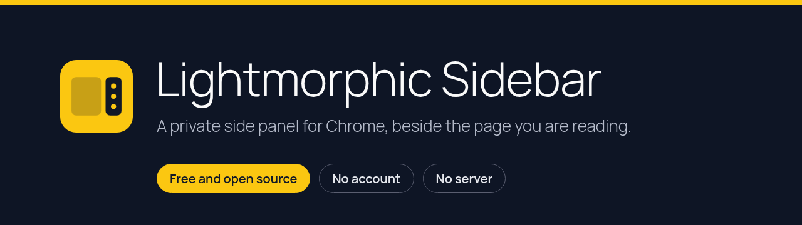
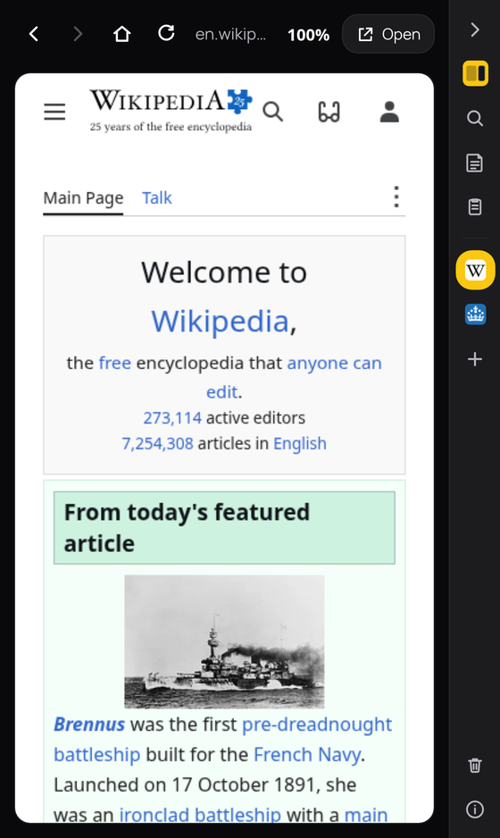
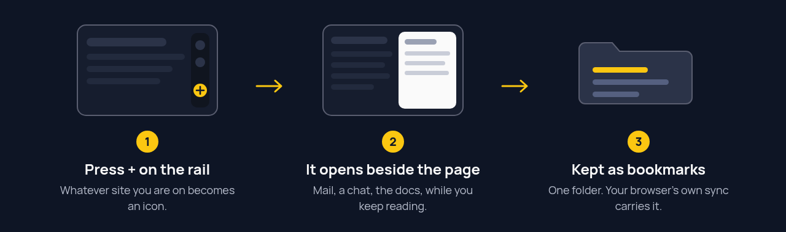
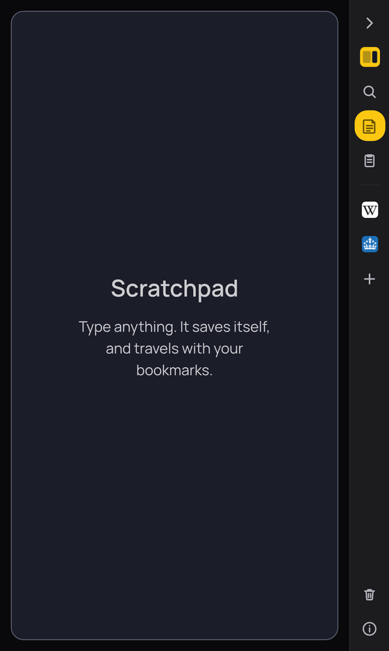
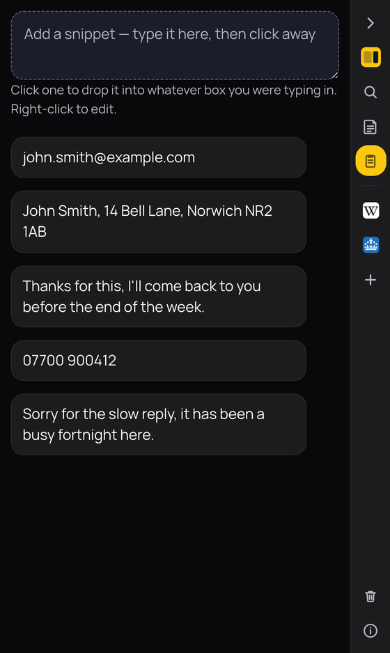

  

  
  
  
  

Lightmorphic Sidebar is a side panel for Chrome. Pin a website to its rail and
the site opens beside the page you are reading, like a small window. The panel
also holds a search box, a scratchpad and a set of snippets, and it stays put
while you move between tabs.

You get one place for the page you keep going back to, with nothing to sign
into. Everything you save is kept as ordinary bookmarks, so your browser's own
sync carries it to your other computers. There is no account and no server of
ours. It needs Chrome 114 or newer, or a Chromium browser that installs Web
Store extensions: Edge, Brave, Vivaldi or Opera. There is no Firefox version.

  

## How it works

## Quick start

Install it from the [Chrome Web Store](https://chromewebstore.google.com/detail/lightmorphic-sidebar/bgppfeckflfdoibaelfolpgcdoifoili), then click
the Lightmorphic Sidebar button in the toolbar to open the panel. To pin a
site, open it in a tab, press **+** on the rail and save.

The one thing that trips people up: the extension installs with access to no
websites, so the first time you open a pinned site the browser asks whether it
may show that one site in the panel. Say yes once for each site, or use
**Allow all sites** in the Information tab if you would rather not be asked.
Decline and the site opens in an ordinary tab instead.

## Pinned sites

Open a site, press **+** on the rail, and it becomes an icon. Click the icon and
the site loads in the panel, beside whatever you are reading: mail, a chat, the
docs you keep checking. The site's icon is taken when you pin it and kept, so
the rail looks right whether or not you have been to the site before.
Right-click an icon to change or remove it, and drag to reorder.

Pages in the panel are asked for their phone layout, because the panel is about
a phone wide. A tab you open yourself is never touched.

## Search, scratchpad and snippets

The panel opens on a search box. A row of letters under it picks the engine
(D for DuckDuckGo, G for Google, I for Google Images, B for Bing, S for
Startpage, M for Mojeek, Q for Qwant), and results open in the panel. Your new
tab page is left alone.

<table>
  <tr>
    <td align="center" width="50%">
       
      <b>Scratchpad</b>
    </td>
    <td align="center" width="50%">
       
      <b>Snippets</b>
    </td>
  </tr>
</table>

The scratchpad saves as you type. Click a snippet and it lands at your cursor in
the box you were last typing in; right-click it to edit.

## Folding it away

The chevron at the top of the rail closes the panel and leaves a small strip of
icons against the edge of the page. Drag the strip by its mark to move it up or
down, and press the cross to send it away. Chrome will not let a side panel be
narrower than 360 pixels, which is why the strip is drawn on the page instead.
It cannot appear on Chrome's own pages, such as settings or the Web Store.

## What it does

- Opens any website in a panel beside the page you are reading.
- Searches with one of seven engines, in the panel or in a tab.
- Keeps a scratchpad and a list of snippets, with the panel remembering both.
- Syncs through your browser's bookmark sync. No account.
- Folds away to a strip of icons on the page.
- Removes everything it has saved, bookmarks folder included, from one button.

## Settings

All of these are in the Information tab. None is required.

| Setting | Default | What it does |
|---|---|---|
| Where search results open | In the panel | Choose the panel or an ordinary tab for search results. |
| Following a result | Stay in the panel | When set to the main window, clicking a result hands it to a tab. |
| Side of the rail and strip | Follow the panel | Left, right, or follow whichever side the browser docks the panel on. |
| Allow all sites | Off | One answer instead of being asked for each site. Press again to take it back. |
| Search engine | DuckDuckGo | The letter under the search box. Your choice is remembered. |

## Where your data lives

Your scratchpad, snippets and pinned sites are bookmarks, in a folder called
**Lightmorphic Sidebar** inside Other Bookmarks, with a copy in the browser's
extension storage. If your browser syncs bookmarks, they follow you. Nothing is
sent to us. The **Danger zone** button on the rail removes all of it, folder
included, and needs a second press to confirm. Chrome gives an extension no chance to ask at
the moment you uninstall it, so that offer has to come beforehand.

## Security

- No account, no server of ours, no analytics, no remote code.
- It installs with access to no websites. Access is asked for one site at a
  time, and you can take it back from the browser's extension settings.
- To show a site in a panel the extension removes the headers that stop a site
  being framed. That rule applies only to the panel itself, never to your tabs,
  and `tools/dnr-test/` proves it on every change.
- A site shown in the panel is that site. We can ask it for its phone layout;
  we are not responsible for what it does.

Found something? Read [SECURITY.md](SECURITY.md).

## Building it yourself

There is no build step. Open `chrome://extensions`, turn on Developer mode,
choose **Load unpacked** and pick the `chrome/` folder.

| Path | What it is |
|---|---|
| `chrome/` | The extension itself |
| `site/` | sidebar.lightmorphic.com, hosted on Cloudflare Pages |
| `store/` | The Web Store listing images and `SUBMIT.md`, the answers to paste into the form |
| `tools/dnr-test/` | Checks that ordinary websites are untouched by the extension. Run `tools/dnr-test/run.sh` |
| `tools/store-shots/` | Rebuilds the listing images from the real extension running |
| `package.sh` | Checks the package and zips `chrome/` for the store |

Contributions are described in [CONTRIBUTING.md](CONTRIBUTING.md).

## Licence

Copyright (c) Lightmorphic Ltd. Version 1.1.0 and later are released under the
GNU General Public License, version 3. The full text is in [LICENSE](LICENSE),
and it ships inside the extension. What changed in each version is in
[CHANGELOG.md](CHANGELOG.md).

## Disclaimer

This software is provided as it is, without warranty of any kind. Websites you
open in the panel are those websites, under their own terms and policies.
